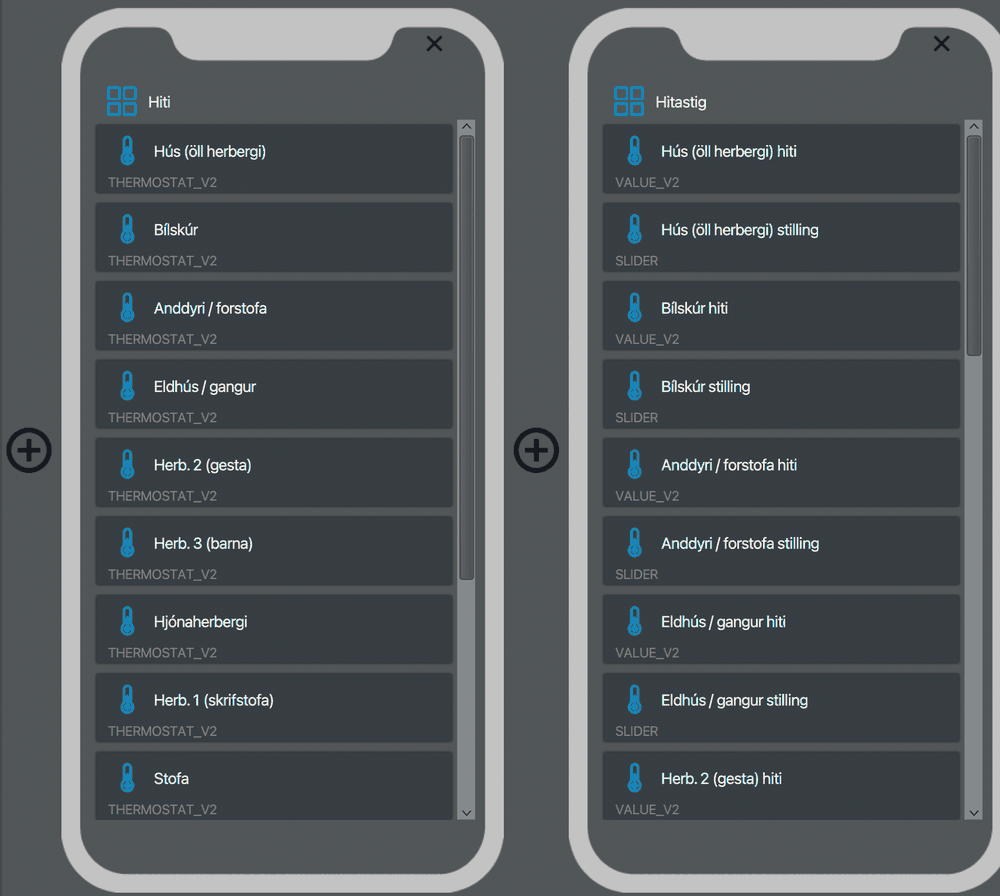
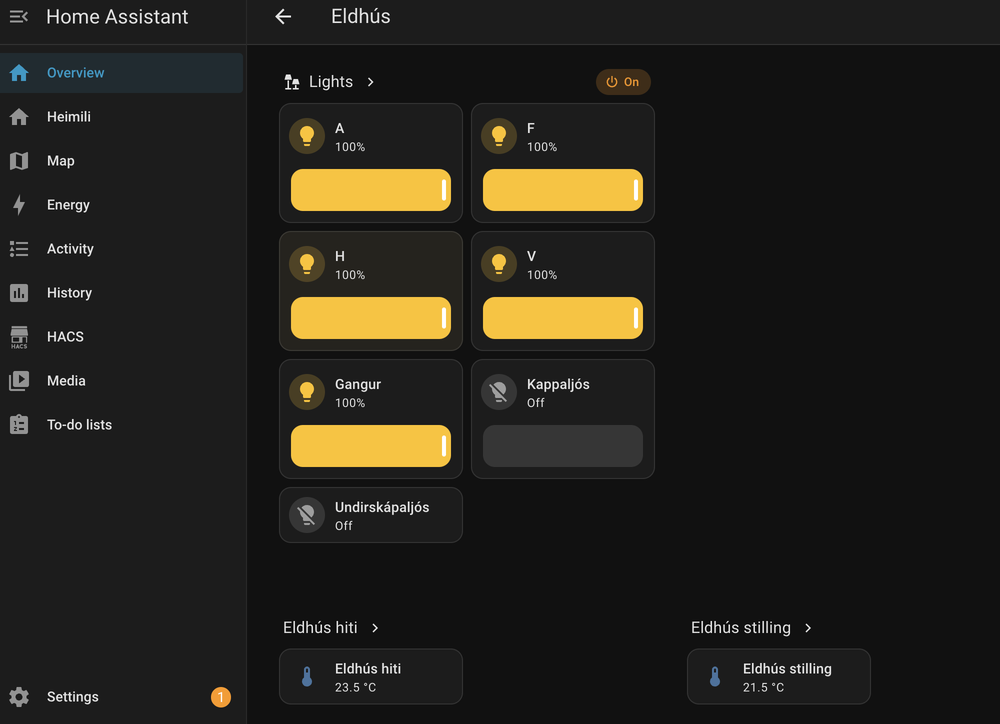

# grenton-home-assistant-kit

Keep a [Grenton](https://www.grenton.com) Object Manager project in git. Generate the
myGrenton interface from one file. Use it to set up Home Assistant with sensible rooms,
names and entity ids.

> Status: early. Extracted from one working house: Object Manager 1.13.1, two CLUs,
> about 35 dimmers and relays and 12 thermostats, Home Assistant 2026.10 with the
> [Grenton integration](https://github.com/sszczep/homeassistant-grenton). Expect rough edges,
> and please open an issue when your installation differs.

| myGrenton interface, generated from `site.yaml` | The same house in Home Assistant after `grenton ha sync` |
|---|---|
|  |  |

## Getting started

```sh
grenton init my-house --omp "My House.omp"   # an OM save or backup
cd my-house
claude                                        # then: /onboard
```

`init` takes the project key into `secrets/`, unpacks the project and writes
`inventory.md`, which lists everything in the project and what controls it. It also
writes a first `site.yaml`. The **`/onboard`** session in Claude Code takes it from there:
- an interview about rooms, names and which loads are dimmable
- a blink test for unknown outputs
- generating the interface
- setting up Home Assistant

Progress is kept in `docs/STATUS.md`, so you can stop and continue later. Without Claude
Code, edit `site.yaml` by hand; the commands below are all there is.

## Idea

One house is one **site folder**:

```
my-house/
  site.yaml        rooms, lights, thermostats, names: what only you know
  project/         the Object Manager project, unpacked (git diffs instead of a zip)
  secrets/         project key and HA token (gitignored)
```

The `grenton` command reads the project for what it already contains: CLUs, modules and
object types. It reads `site.yaml` for the rest.

- `grenton omp unpack|pack|import-workspace`: move the project between Object Manager
  and git. Packing gives back a byte-identical `.omp` when nothing changed. The
  project key is replaced with a placeholder in git and only restored in the `.omp`.
- `grenton omp add-event-command|set-feature|add-script ...`: small, reviewable edits.
- `grenton discover`: describes the project in `inventory.md` and drafts `site.yaml`.
- `grenton mygrenton build`: writes the myGrenton interface (pages, dimmers, on/off,
  thermostats, temperature values, setpoint sliders) into the project. Open it in OM and
  send.
- `grenton ha sync [--apply]`: after the HA Grenton integration has imported the interface,
  it sets areas, device and entity names, and entity ids. It also wraps on/off loads as
  lights, creates light groups, sets thermostat units, and writes a dashboard. It's a dry
  run unless you pass `--apply`.
- `grenton ha blink <light>`: flashes a light, then restores it. It finds unknown
  outputs, so someone must be on site.

See [`examples/site.example.yaml`](examples/site.example.yaml) for every key.

## Documentation

- [Workflow](docs/workflow.md): new house, every change, HA after an interface change
- [The .omp file](docs/omp-format.md): what's inside and how to edit it safely
- [myGrenton interfaces](docs/mygrenton-format.md): storage, bindings, widget indices
- [Home Assistant](docs/home-assistant.md): the integration, and what `ha sync` does
- [Lessons](docs/lessons.md): things that cost time on a real installation
- [Roadmap](docs/ROADMAP.md)

## Install

```sh
uv tool install git+https://github.com/hlodver/grenton-home-assistant-kit   # or: uv run --project <clone> grenton ...
```

## Related projects

- **[sszczep/homeassistant-grenton](https://github.com/sszczep/homeassistant-grenton)**: the HA
  integration this kit is built for. It imports the myGrenton interface from Object Manager and
  talks to the CLUs at runtime. This kit generates that interface and tidies up what the
  integration creates. It doesn't replace the integration.
- **[jnalepka/grenton-to-homeassistant](https://github.com/jnalepka/grenton-to-homeassistant)**:
  a different integration. You configure entities in HA, and Lua scripts plus an HTTP listener
  on the CLU push state changes. It's a good fit if you prefer to set things up from the HA
  side. This kit's `omp` tools can still keep such a project in git.

## License

MIT. Not affiliated with Grenton.
